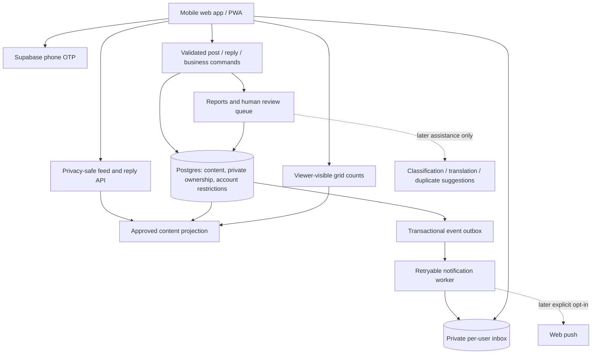

# GridSpace first release execution blueprint

Decision date: 22 November 2026. Audience: product, engineering, design, trust and safety, community operations and growth.

Build one useful neighborhood conversation loop: **open a grid → notice something useful → respond or contribute → receive a meaningful update → return**. Launch a small supported trial before monetization or a framework rewrite. Use the supplied PRD as the longer-term vision; the user's narrower follow-up requirements govern this first release.

This blueprint proposes the next work. It does not mean these features have been implemented or deployed. The PRD's description of a no-login prototype is outdated: local code now contains phone OTP, persistent accounts and shared-data paths. The PRD's low-retention assertion is a product hypothesis; no measured retention cohort was supplied.

## 1. Scope and decisions

| Ship in the first release | Defer |
| --- | --- |
| India phone OTP and a pseudonymous username | Mandatory real names; Google as a separate account silo |
| One selected neighborhood, with read-only discovery elsewhere | User-controlled changes to grid geometry |
| A unified feed of thoughts, civic issues and local business updates | Separate competing feeds for each category |
| Share as me / Share privately, with explicit audience explanations | A shared GridVoice account or collective persona |
| Flat replies directly under a root post | Replies to replies, quote-posts, direct messaging |
| In-app reply notifications and followed-grid digests | Web push until preferences and the return loop are validated |
| Report, block, suspension, review, appeals and account deletion | Automated AI account penalties or public moderation verdicts |
| Server-derived counts of currently visible grid updates | Red severity-style heatmaps, popularity scores or mood animations |
| Five manually onboarded local businesses, one optional image each | Animated hexagonal media feeds, payments and paid ad inventory |

A mobile-first web/PWA trial is the initial delivery. A native store release is a separate review gate. Apple and Google have UGC requirements covering reporting, blocking and ongoing moderation; a political-content ban alone does not establish compliance. [Apple guidelines](https://developer.apple.com/app-store/review/guidelines/), [Google Play UGC policy](https://support.google.com/googleplay/android-developer/answer/9876937).

## 2. Starting point and gaps

| Area | Current local implementation | Work needed |
| --- | --- | --- |
| Accounts | India OTP UI, username generation, stable Auth UUID, anonymous-account linking path | Hosted Phone Auth/SMS, CAPTCHA, real-device acceptance and number-change policy |
| Shared content | Postgres-backed thoughts/issues/offers, owner and moderator visibility rules | Hosted two-user verification and a privacy-safe API before hidden-author posting |
| Feed updates | Refresh button, focus refresh and 30-second polling | Replies and transactional notification events |
| Moderation | Issue/report queue, business approve/hide and owner deletion | Durable user suspension, user-to-user blocking, appeals and operating coverage |
| Businesses | Name/type/pin, hours, offer, local-business attestation and review | Informal-vendor location modes, one approved photo, editing and renewal |
| Map | Fixed grid calculations and activity derived from loaded browser data | Authoritative counts, a shared grid version and consistent visibility rules |
| Engagement | Followed grids; preview-style notification state | Durable per-user inbox, read state and meaningful-update preferences |

The current shared-feed query requests `author_id`. Hiding a name in the interface would not protect authors from API inspection. Do not launch the hidden-username mode until the API and ownership storage boundaries change.

The hosted blocker most recently reported was `phone_provider_disabled`. Hosted SMS settings, the new database migration and real browser flows remain unverified. Local embedded-Postgres tests model SQL authorization; they are not carrier, GoTrue, Storage HTTP or browser acceptance tests.

## 3. Engineering and systems architecture

### Keep the existing delivery path

Keep the plain JavaScript product app for this release. Keep the separate Next.js marketing site separate. Use Supabase Auth, Postgres, RLS, Storage and existing Edge Functions; indexed grid IDs are sufficient for the bounded trial. Defer PostGIS/H3 adoption until a measured query or geography requirement justifies a migration.

For the preferred GCP frontend target, serve the existing static build through Firebase Hosting and retain Supabase as the backend. That does not move the database to GCP. Use one staging hosting target at a time; the existing Vercel preview can remain the review surface until Firebase project access is established. Keep policy headers and exact function origins consistent. Add Cloud Run only when a specific worker workload requires it.

### Proposed schema and access boundaries

These are logical models for additive migrations, not instructions to expose new public tables directly.

| Model | Essential fields | Visibility and rules |
| --- | --- | --- |
| `auth.users` | Auth UUID, phone identity | Auth-managed; no phone in public profiles or analytics |
| `profiles` | Auth UUID, immutable username | Owner account data; separate opt-in public profile projection |
| `private.content_owners` | Content ID, Auth UUID, identity mode | Server/moderators with audited need; never a neighbor-readable author map |
| Content records/projection | Opaque content ID, versioned grid ID, kind, body, display author, status, expiry | API returns username only for Share as me; hidden mode has no stable author identifier |
| `replies` | Reply ID, root content ID, body, status, timestamps | Exactly one root parent; no parent-reply field; same audience and visibility as root |
| `private.reply_owners` | Reply ID, Auth UUID, identity mode | Same identity protections as root posts |
| `private.user_restrictions` | Account ID, restriction, reason, start/end, actor | Server-owned; enrollment must not reset or bypass a suspension |
| `private.user_blocks` | Blocking account, blocked account, timestamp | Owned relationship; resolve hidden authors server-side from content IDs |
| `notifications` | Recipient, type, root/reply reference, created/read time | Only recipient may read or mark read; no phone or hidden-author ID in payload |
| `private.event_outbox` | Event ID, subject, recipient resolution data, retry state | Transactional with successful writes; not browser-readable |
| Business/listing records | Owner, public name/category/pin, location mode, hours/timezone, optional approved image, status/expiry | Owner/moderator see drafts; neighbors see approved active listing only |
| Grid configuration | Version, geometry parameters, effective status | Readable configuration; owner-reviewed changes and explicit migration |
| Moderation decisions | Target, policy version, reviewer, reason, appeal/result | Restricted audit; not a public accusation feed |

Public content IDs must be unrelated to Auth UUIDs. Do not expose hidden identity through REST fields, nested joins, URLs, media paths, error messages, exports, analytics or Realtime payloads. A reply on a hidden-author post must not reveal its owner indirectly through notification data.

Replace the current direct feed reads in stages: add and test the safe API; move clients; revoke legacy neighbor access to raw ownership fields. Merely creating a view is insufficient: views can bypass RLS unless their permission behavior is deliberately configured. Where RLS must remain authoritative, use security-invoker views or narrowly checked server functions, not a broadly privileged convenience view. [Supabase RLS guidance](https://supabase.com/docs/guides/database/postgres/row-level-security).

### Commands, consistency and performance

- `create_post` / `create_reply`: derive actor from the session; validate restriction status, grid eligibility, root visibility, length and rate limits. Store ownership privately. Do not accept a trusted owner ID from the client.
- `create_reply` accepts a root content ID only. Root deletion/hiding closes further replies and prevents notification previews from exposing it. No self-reply notification.
- Account suspension applies in RLS and every privileged command, including phone enrollment and Storage authorization. Session revocation alone is not the application restriction mechanism.
- `block_author_of(content_id)` resolves the author privately and records the caller's block. Do not return the hidden account ID. Blocking can affect visible patterns, so do not promise absolute anonymity or impossibility of inference.
- Write the content and outbox event in the same transaction. Notification insertion is idempotent on event, recipient and notification type. A retry must not create duplicate alerts.
- Keep polling for feed reads initially. Realtime, if introduced, publishes only safe content projections and recipient-authorized notifications, never private ownership tables.
- Index root/time for replies, grid/status/time for content, recipient/read-state/time for notifications and actor/active-window for restrictions. Paginate; fetch counts for the current viewport in one bounded request, not one request per hexagon.
- Retain fixed grid geometry for the trial. Attach a grid version to new records before a future size change. Preserve or explicitly migrate old follows/content; never reinterpret old axial IDs silently.

### Retention and deletion

Phone ownership restores the same account while the number remains controlled by the user. A username is not a recovery secret. Document number loss/reassignment and add a linked recovery method before merchant accounts hold material value.

Proposed discussion retention: keep published thoughts for seven days unless removed earlier, with replies inheriting root visibility/expiry. Civic issues keep an explicit resolution/expiry policy; business questions follow their offer's validity. The seven-day thought window changes the current 24-hour lifetime and needs product/privacy approval and a migration before measurement. Replace the current delete-oldest behavior at 15 thoughts with pagination so a new post cannot silently destroy an active conversation. Keep existing root-post seed controls for the first trial; replies do not consume those seeds. Business schedules expire independently. Define backup, abuse-evidence and account-deletion retention with the responsible privacy owner; do not promise immediate erasure from every backup.

## 4. UI and UX specifications

### Neighborhood and feed

Use the current quiet system typography, rounded surfaces, clear labels and neighborhood illustrations. One selected grid anchors the map and feed. Thoughts, issues and business updates share chronological ordering with category labels. No infinite recommendation feed or default engagement ranking.

An unavailable or uncertain device location offers read-only area selection; it must not masquerade as confirmed presence. Posting and business-pin changes still use server-checked eligibility. “Current grid” is not proof of residence.

Each feed card shows category, safe author display, time, content, reply count and a menu for reporting/blocking. “Awaiting review” is owner-only. Distinguish an empty grid, an offline/stale view and a failed fetch. Never display seeded examples as real neighbor activity.

### Posting modes

Keep the requested labels, with audience copy immediately beside the control:

| Selection | Preview | Required explanation |
| --- | --- | --- |
| Share as me | `neighbor_… · Thought` | Your pseudonymous username appears with this post. |
| Share privately | `A neighbor · Thought` | This post is visible in the grid. Your username is hidden from neighbors; authorized moderators can connect it to your account. |

“Privately” describes author visibility, not a private audience or a direct message. Start the composer in the more protective hidden-username mode, show the selected mode in the submission preview, and require an explicit switch to show the username. Business listings publish under the business name with a separately explained public pin. No automatic real-name import from the phone account.

Legacy posts must not be relabelled as if their author IDs had never been exposed; the safe API protects future access, not information already downloaded. Do not offer identity-mode edits on published content in the first release: removing a username later cannot undo an earlier disclosure. Offer deletion instead, subject to the product's deletion policy.

### Flat replies

Selecting Replies opens a sheet on mobile and a conversation panel on larger screens. Show the root, chronological replies and one composer. Each reply belongs directly to the root. An optional “Original poster” badge can be computed server-side without revealing the hidden owner ID. Do not add nested indentation or reply-to-reply interactions.

Proposed pilot defaults: replies are at most 500 characters, with server-enforced limits of five per minute and 30 per hour per account. These are adjustable abuse controls, not empirically optimized engagement settings. Allow at most one identical reply per account/root within ten minutes, and count only committed, non-removed replies.

Show “This conversation is no longer available” for a removed target; no cached body/author in its notification preview. Owners can delete their contributions; reports are not public comments.

### In-app notifications first

Notify the root author of a substantive reply, including a question about their business. Batch followed-grid activity into a digest notification rather than notifying on every post. Suppress self-events, blocked-actor events, pending/hidden content and duplicate retries. Replies on unpublished business submissions do not create public notifications.

Provide per-grid updates on/off, reply notifications on/off, mark read and a global quiet preference. Unread counts include only accessible notifications. Web push is Phase 2, with a separate opt-in, quiet hours and device subscription management. Do not use login SMS numbers for activity alerts or marketing.

### Map activity

Use an exact count of currently visible root updates at readable zoom and a restrained single-color marker when zoomed out. Suggested display bands are 0, 1–4 and 5+ updates; these are provisional visual thresholds, not validated engagement targets. Do not use red to imply urgency, emojis to imply sentiment or animations to imply popularity.

Counts exclude pending, hidden, expired and viewer-blocked content. Replies are shown in the conversation rather than inflating the root-update count. The label is “current updates,” not “activity over seven days.” The present browser-loaded, capped content cache cannot establish a complete community count and must be replaced for this feature.

### Informal vendor onboarding

Pani puri vendors, chai carts, dosa stalls, flower sellers, repair kiosks, tailoring shops and home bakers are first-class use cases. A government business-registration number is not required for this trial. Manual approval is a content/local-relevance review, not certified ownership or a verified commercial address.

Use one phone account for both resident participation and business ownership. Collect:

1. A recognizable public name/description and category.
2. A vendor-selected public pin, with an explicit public-location acknowledgement.
3. A location mode and hours, described below.
4. One optional image, a short useful update and an optional contact/directions link.
5. Owner/authorized-poster attestation and a final preview, then human review.

| Mode | Display and lifetime | Rule |
| --- | --- | --- |
| Usually here | “Usually here · 5–10 pm” | Recurring hours and a visible last-updated date; renewal reminder before expiry |
| Here today | “Here today · updated 2h ago” | Vendor chooses an end time; maximum 24-hour listing window; hide automatically on expiry |
| Available during these hours | Listed schedule in Asia/Kolkata | Validate overnight ranges and date boundaries server-side; do not imply live occupancy |

Moving vendors update their own public pin after a fresh eligibility check. Do not track them continuously or reuse exact resident coordinates automatically. A home baker can select a public pickup point instead of publishing a home address. A public contact link requires separate consent and must not be prefilled from the private login number.

Accept one optional JPEG/PNG/WebP, at most 2 MiB after processing, re-encode to a maximum 1280 px edge, remove embedded metadata, verify decoded type/size server-side and review it before publication. Clearly label an illustration; never present an invented storefront image as a photograph of the actual vendor. Use opaque media IDs. No moving image sequence, paid badge or hexagonal carousel is required. The map hex remains a navigation unit, not a mandatory photo crop.

## 5. Trust, safety and AI assistance

### Content policy

Allow local civic discussion, including criticism of roads, water, transport and local-government services. Prohibit targeted political campaigning/solicitation, harassment, threats, doxxing, discriminatory abuse, dangerous deception and inflammatory election manipulation. Route disputed factual claims and borderline civic/political cases to trained reviewers; do not treat criticism of an official as an automatic violation.

Publish examples and an appeal path. Applicable privacy, intermediary, SMS and consumer obligations need review for the actual operating entity and launch jurisdiction. Neither this policy nor selecting a cloud provider guarantees legal or app-store approval. Native app positioning should remain place-based community utility rather than random anonymous chat; review the current store rules before submitting.

### Warning and restriction state machine

The following thresholds are proposed operating policy for the pilot, not measured optimal thresholds. Product and trust/safety owners approve them before release.

| Trigger | User experience | Server action |
| --- | --- | --- |
| Possible minor issue | “This may include a personal detail or wording that could hurt someone. Edit it, or send it for review.” | Offer editing/review. An AI suggestion alone is not a strike. |
| First human-confirmed minor violation in 90 days | Private explanation naming the rule and appeal action | Remove/limit the specific item; record one confirmed violation. |
| Second confirmed minor violation in 90 days | Explain repeated behavior and review status | Require human review for new contributions for seven days. |
| Third confirmed minor violation in 90 days | Explain a temporary posting pause and appeal | Seven-day posting suspension; a human sets scope and expiry. |
| Credible severe threat, doxxing or other urgent harm | Private safety notice without exposing another reporter | Immediately contain the item provisionally and escalate to a human; restrictions may bypass the minor-warning sequence. |
| Appeal succeeds or restriction expires | Notify the account privately | Reverse the applicable restriction/strike; preserve the decision audit. |

Keep warning history separate from access state: active, review-required, posting-suspended and fully suspended. Do not show a public “flagged user” badge. Fully suspended accounts retain a narrow route for appeal and account deletion; they must not silently re-enroll through phone login. Moderators need reasons, expiry, evidence access controls and audited reversal.

### AI role

First release moderation is human-led. Later, a server-side worker may suggest harm categories, likely duplicates, translations and summaries. Treat content as untrusted input, minimize identifiers sent to the model, store model/policy versions and evaluate false positives in English, Tamil and code-switched examples before enabling assistance.

A general moderation endpoint supplies defined harm categories; it does not establish truth or implement this product's political-campaigning rules automatically. Reviewers make borderline decisions, and any public action cites the product rule rather than “the AI said so.” Optional translations/summaries are labelled and link to the original; never silently replace a resident's words. [Moderation API documentation](https://developers.openai.com/api/docs/guides/moderation).

## 6. Community launch and business operations

Start with one walkable neighborhood, five consenting vendors and roughly 30 invited residents. These are proposed pilot sizes, not proven demand or growth projections. Prefer a mix of familiar repeat-use services: pani puri/chai, a repair service, flowers and a small shop/home baker.

The community lead helps each vendor publish an accurate pin, schedule and one genuine update. Give them a QR link to their grid/listing and a short explanation they can share with customers. Recruit through consenting local groups and in-person introductions; do not upload address books or contact the private OTP numbers for promotion.

Seed the product through real participation: useful local observations, vendor hours and answers to genuine questions. Staff contributions must be identifiable; do not invent neighbors, reviews, demand, posts or activity counts. A moderator and support contact must be reachable during published operating hours. Pause expansion if review demand exceeds staffing.

Run a two-week supported pilot after acceptance, then interview both returning and non-returning residents and all five vendors. A quiet neighborhood may need a better use case or timing, not more notifications.

No paid advertising in Phase 1. After repeated demonstrated vendor value, evaluate an optional merchant subscription for campaign tools or clearly labelled promotion. Do not sell phone-number access, charge for civic issue visibility or guarantee footfall from impressions. Payment verification, entitlement checks, cancellation/refunds and reporting precede any charge. The earlier INR 499/month example remains an unvalidated pricing hypothesis.

## 7. Measurement contract

Decisions: weekly, decide whether to fix onboarding, improve conversation value, reduce notification noise, or expand the cohort. No measured baseline or benchmark has been supplied; do not describe any target as achieved or infer causal retention improvement from adding replies.

Use server timestamps in UTC, report calendar days in Asia/Kolkata and distinguish residents, vendors and staff. Exclude test/staff activity and known bots from the primary cohort. Keep raw counts and denominators beside rates. Instrument no raw phone, exact coordinates, post body or OTP in product analytics. Use an access-restricted pseudonymous analytics identity with a deletion/retention policy.

### Primary measures

| Measure | Exact definition | Decision and limitation |
| --- | --- | --- |
| Weekly meaningful returners — north star | Distinct non-staff activated users who return on a later local calendar day and perform a meaningful action during a complete reporting week | Tests repeated value. A meaningful action is a successful non-self reply/contribution, opening a reply conversation from the inbox, or an explicit business-directions action; a page load alone does not qualify. These actions are proxies, not proof of satisfaction or a purchase. |
| D7 meaningful retention | Activated users with a meaningful action on local day 7 after activation ÷ activated users whose full day-7 window has elapsed | Compare mature activation cohorts. Activation is the first meaningful action, not SMS verification. Also report invited → verified → activated counts so poor activation is not hidden. |

Driver 1: **24-hour activation rate** = newly verified users with a meaningful action within 24 hours / newly verified users with a complete 24-hour observation window.

Driver 2: **48-hour response coverage** = eligible published roots receiving at least one non-self, non-staff, non-removed reply within 48 hours / eligible published roots with a complete 48-hour window. Define eligible roots as those permitting replies and published for the observation window. Report early removals separately so exclusion cannot hide a safety problem.

### Guardrails and diagnostics

- Safety guardrail: open urgent reports beyond the team's explicitly staffed response window; review every urgent missed case before cohort expansion. No automated urgent-response promise outside actual staffing.
- Notification guardrail: unique notified users who mute reply/grid notifications within seven days / notified users with a mature seven-day window. Treat mutes as preference signals, not proof of harm; pair with interviews.
- D30 uses the same retention definition on day 30 and remains unavailable until cohorts mature. Reply-to-post ratio is a diagnostic, not the north star: one argument can produce many replies. A directions click is not a sale.
- For future push, distinguish provider acceptance, device delivery and user opening. If delivery is unobservable, call the measure “opens per accepted dispatch,” not delivery-based CTR.

Minimum event vocabulary: `account_verified`, `grid_opened`, `post_published`, `reply_published`, `notification_created`, `notification_opened`, `notification_preference_changed`, `business_update_approved`, `business_directions_clicked`, `report_created`, `moderation_decided` and `account_deleted`. Server events follow committed successful actions; client events use event IDs and deduplication. Staff/moderation events do not count as resident engagement.

Set outcome targets after the first complete pilot cohorts and interviews. For a small cohort, report n/N and individual failure reasons; do not present tiny changes as statistically established lift. Non-negotiable launch gates are correctness tests, not invented market benchmarks.

## 8. Backlog, ownership and sequence

Planning assumption: two full-stack engineers, a part-time designer/QA partner, a community lead and a named human moderation owner. Roles may be combined, but moderation/support cannot be unassigned. Estimates below are engineering effort ranges, excluding SMS-provider approval, legal review and access delays.

| Ticket | Accountable owner | Dependencies | Acceptance condition | Estimate |
| --- | --- | --- | --- | --- |
| GS-01 Hosted identity and recovery | Engineering lead | SMS provider and authorized staging access | Two real phones sign in; same account returns; legacy linking preserves ownership; wrong/expired codes and limits work | 1–3 days plus external lead time |
| GS-02 Suspension and blocking | Trust/safety + backend | Account model | Restricted user cannot post/re-enroll through any protected path; block-by-content reveals no hidden author ID; appeal/reversal audited | 4–6 days |
| GS-03 Safe authorship API | Backend + frontend | Schema/API migration plan | API, media and event payload tests cannot correlate hidden posts through account identifiers; old direct ownership reads revoked | 4–6 days |
| GS-04 Flat replies | Full-stack + design | GS-02, GS-03 | A replies to B's visible root; no nesting; pagination replaces oldest-root deletion; deletes/hides propagate; unauthorized and rate-limited writes fail | 4–6 days |
| GS-05 Outbox and inbox | Backend + frontend | GS-04 | Reply creates exactly one recipient alert despite retry; no self/blocked/hidden alerts; read state persists | 3–5 days |
| GS-06 Grid count API | Backend + design | GS-02, GS-03 | Counts match viewer-visible roots across statuses, expiry and blocks; viewport request is bounded | 2–3 days |
| GS-07 Informal vendor listing | Full-stack + community | GS-01–03 | All three location modes, one reviewed image, public-pin acknowledgement, expiry and owner renewal work | 4–6 days |
| GS-08 Measurement events | Product + engineering | Event definitions | Cohort calculations reconcile with committed events; staff/test users excluded; no phone/content in analytics | 2–3 days |
| GS-09 Device and abuse acceptance | QA + trust/safety | GS-01–08 | Cross-account, browser, location, moderation, media and outage matrix passes | 3–5 days |
| GS-10 Supported neighborhood pilot | Community + product | GS-09 and staffed operations | Five vendor listings onboarded; real cohort observed; review failures and repeat-use interviews drive the next decision | Two-week observation, not engineering effort |

**Phase 1, sprint 1:** GS-01, GS-02 and the first safe-API work. Freeze the public contract and identity-mode copy before replies.

**Phase 1, sprint 2:** complete GS-03; GS-04 and GS-05. Demonstrate a two-account reply → inbox → return loop before starting extra engagement features.

**Phase 1, sprint 3:** GS-06–09, vendor onboarding and acceptance. The three-sprint outline assumes parallel engineering and is a planning envelope, not a delivery commitment; re-estimate after the identity migration and provider setup.

**Phase 1 pilot:** GS-10. Do not expand because the calendar says so; review mature cohorts, support workload and observed usefulness.

**Phase 2:** opt-in push, evaluated AI assistance, merchant editing/campaign tools and paid entitlements only after trial evidence. Consider framework/geospatial upgrades when a measured bottleneck warrants them. The animated business feed remains optional even in Phase 2.

## 9. Release gates and risk ownership

| Risk | Concrete mitigation | Owner and gate |
| --- | --- | --- |
| Hidden-author identity leaks or inconsistent grid/access checks | Safe API with private ownership, versioned geometry, raw-payload/cross-account tests and server-side restrictions; no trusted client actor/status | Engineering lead: block hidden-author release until tests pass |
| Abuse, privacy or native-store rejection | Reporting, block/suspend, contact/appeal path, trained reviewer coverage, media consent and an operating-entity privacy/UGC review; review store policy when native submission is planned | Trust/safety owner: block customer launch without staffed response and disclosure |
| Empty grids, notification fatigue or no vendor value | One compact cohort, genuine contributions, restrained digests, vendor hours/questions, interviews and mature cohort measurement; pause acquisition when repeat usefulness is absent | Product/community: expansion requires evidence review, not raw signup totals |

Security acceptance includes a suspended user's existing session attempting direct REST, privileged functions, Storage, enrollment and notification APIs; a hidden author's identifier being searched in every network payload; a failed outbox worker retry; a removed root opened through an old notification; an expired Here today listing; an approximate/manual location attempting to publish; and an account deletion with replies, notifications, business media and appeals present.

Operational acceptance includes restore-tested backups, functioning error alerts, exact staging/production origins, provider spending controls, privacy/support pages, a moderation rota, rollback instructions and documented retention. No production approval is implied by this blueprint.

## 10. Evidence and implementation references

- User-supplied Product Production House PRD and subsequent scope/vendor refinements govern product decisions.
- [Current phone implementation](phone-otp-login.md), [staging and pilot checklist](PRODUCTION_TRIAL.md), [deployment setup](DEPLOYMENT.md).
- Local source: `app.js`, `supabase/functions/assign-home-grid/index.ts`, `supabase/migrations/20261122120000_phone_accounts_and_business_submissions.sql` and the existing regression tests.
- [Supabase RLS](https://supabase.com/docs/guides/database/postgres/row-level-security) and [phone sign-in](https://supabase.com/docs/guides/auth/phone-login).
- [Apple App Review Guidelines](https://developer.apple.com/app-store/review/guidelines/) and [Google Play UGC policy](https://support.google.com/googleplay/android-developer/answer/9876937) apply to their respective native-store paths; they are not proof of approval.
- [Moderation API guide](https://developers.openai.com/api/docs/guides/moderation) describes model categories, not an automated implementation of GridSpace policy.
