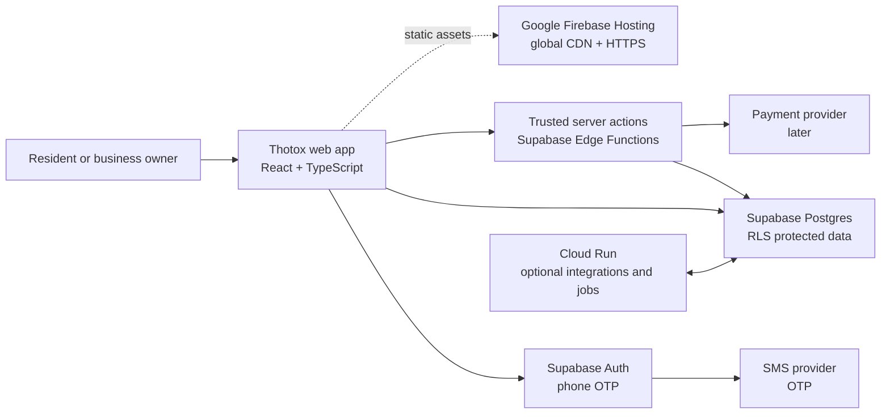

# Production architecture and launch path

## Recommendation

Keep this plain HTML preview while the product is changing quickly, then move the production app to **TypeScript + React + Vite** before the first shared-data pilot. Do not choose a framework because “large apps need one”; choose it because this product is growing into distinct map, feed, account, business onboarding, moderation, and subscription flows. TypeScript catches mismatched data and auth states early; React lets those flows become small components; Vite provides a lightweight build and preview workflow. Keep the map/grid math in framework-independent TypeScript modules so the map can be optimized independently.

The browser remains responsible for presentation: render the map, collect input, show optimistic UI, and call the service. It must not be the authority for ownership, location eligibility, ad billing, business verification, grid capacity, moderation, notification fan-out, or rate limits.

## Service boundaries

Use Supabase directly from the app for ordinary reads and writes **only when row-level security (RLS) fully enforces access**. Use Edge Functions for operations that need secrets or a trusted transaction boundary, such as accepting a paid offer, validating a business submission, or handling a payment webhook. Add Cloud Run only when a concrete service needs it: for example, a more involved Places integration, image-processing worker, or scheduled moderation/notification job. Avoid a pass-through middleware endpoint for every query; it adds latency and operating cost without adding security if authorization still lives in the browser. Supabase RLS is the database authorization boundary and must be tested for every exposed table.

## Frontend and hosting

For the first India pilot, use Firebase Hosting in a Google Cloud project for the compiled static web app. It is designed for static and single-page apps, serves through a global CDN, and provides HTTPS/custom domains. Host `/gridspace/` with an explicit Vite base path and a hosting rewrite for client-side routes. Keep the source map tiles and land mask as separately cacheable assets. Create a Cloud Run service only when the product needs a trusted custom API; it scales down when idle by default, but it still introduces a billable service and should be costed and monitored. Google Cloud Storage alone is not an HTTPS custom-domain setup: Google's documented path uses a load balancer and may add costs.

Keep Supabase as the auth/database source of truth. GCP hosting does not require moving the database to GCP. Set budget alerts and billing caps/quotas where available before deployment; a free quota is a limit, not a guarantee that the full production stack has no charges.

## Supabase project decision

The first pilot project is `thotox-india-pilot` in **Mumbai (`ap-south-1`)** under the `aadithrajkv` organization. It is active on the $0/month plan. Core tables and RLS policies are applied through versioned migrations in `supabase/migrations/`; `supabase/database.types.ts` contains generated client types. The browser config contains only the public publishable key. Hosted phone auth remains disabled because no SMS provider is configured. The old paused Sydney project is separately authorized for deletion, but cleanup still needs an authenticated Dashboard session.

For an India-first pilot, use the Mumbai project as the production candidate. Before launch, confirm region latency, backups, spend controls, and data handling. The paused Sydney project is not used by this pilot.

## Account and business model

Use one phone-authenticated user account for both neighborhood participation and business ownership. Business is an optional **profile/role**, not a separate login. This avoids asking a person who both lives nearby and runs a stall to maintain two identities. Keep a separate `business_profiles` record owned by the user; later, if shops need multiple staff, add a `business_members` table with explicit roles rather than sharing phone OTP credentials.

The local login screen now includes a “I run a local business” walkthrough. It previews three steps and explains the privacy split. The real flow should be:

1. Sign in with the same mobile OTP.
2. Choose “Set up a business profile”. Enter public name/category, place the pin, and set opening hours.
3. Submit the minimum evidence needed to verify that this is a local business. Keep evidence in a private review bucket, accessible only to the owner and reviewers; set a retention/delete policy.
4. Choose an optional **separate public listing image** or emoji. Compress on-device, strip EXIF/GPS metadata, moderate it, and show a crop/size preview.
5. Preview how the listing appears on a grid and in the feed. Submit it for review; after approval, publish an offer and schedule.

Never display the verification photo as the public grid image. They have different audiences and retention. For the first pilot, prefer manual verification and a public image upload as optional; do not collect Aadhaar or other government identity documents unless legal counsel determines they are necessary and the product has a protected KYC process.

## First release data model

- `profiles(user_id, display_name, created_at)` for minimal account-level information.
- `thoughts(id, grid_id, author_id, body, emoji, created_at, expires_at, status)` with owner delete and moderation states.
- `grid_subscriptions(user_id, grid_id, label, last_seen_at)` unique per user/grid.
- `business_profiles(id, owner_id, public_name, category, location, hours, verification_status)`; do not put private evidence in this row.
- `business_verification_files(id, business_id, storage_path, review_status, retention_until)` in private storage with owner/reviewer policies.
- `offers(id, business_id, grid_id, public_image_path, body, active_from, active_until, status)`.
- `grid_issues(id, grid_id, author_id, category, body, image_path, moderation_status, expires_at)`; issue photo paths point to a private bucket and new reports require moderation.
- `grid_events(id, grid_id, actor_id, kind, entity_id, created_at)` as a compact source for in-app updates.

Enable RLS on every exposed table and private storage bucket. Derive `author_id` and `owner_id` from the authenticated session, not submitted browser fields. Keep exact user coordinates private; calculate or validate the grid server-side where the rule protects posting or pricing. Add indexes on grid ID, owner ID, status, and time filters. Use a moderation/report queue before public launch.

For this product direction, the shared feed has three grid-scoped contribution labels: local issue, local business, and thought. The current screen demonstrates that flow locally; it does not yet read or write the shared schema. See `launch-readiness.md` for the exact domain and release blockers.

## Go-to-market sequence

### Stage 1: product foundation

- Decide the pilot boundary (one compact neighborhood in Chennai) and the public-posting/privacy rules.
- Move `index.html` into the TypeScript/Vite app without changing its visual behavior. Add route/component boundaries, format/lint rules, and automated checks for auth, grid conversion, and access rules.
- Choose the Supabase Mumbai project and configure OTP fixed test numbers first; configure a real SMS provider only after rate limits, India sender/template requirements, and per-message budget are known.

### Stage 2: safe shared pilot

- Add database schema, RLS policies, and tests before swapping local storage for shared reads/writes.
- Add account deletion, thought delete/report, moderation status, operator tools, and data retention.
- Invite a small resident cohort; use one account for both residents and optional business owners.
- Do not charge for ads or advertise push notifications yet. Manually onboard a few vendors and measure whether customers actually use the offers.

### Stage 3: limited launch

- Add business ownership review, separate private evidence storage, public listing media moderation, and scheduled offers.
- Add payment provider only after legal/commercial setup and server-verified webhooks exist; never mark a browser-only payment result as paid.
- Add in-app Realtime updates; add web/mobile push only when retention data shows it is useful.
- Deploy the static app on Firebase Hosting under `thotox.com/gridspace`; add Cloud Run only for a measured backend need.

## Decisions needed before cloud changes

1. Should the paused Sydney project be kept as a reference/dev project, or is it safe to leave it dormant while we use a new Mumbai project?
2. Which GCP project/account should host Firebase Hosting, and is billing already enabled? Creating a Cloud project or load balancer can incur cost.
3. Which neighborhood and cohort are in the first pilot?
4. Are local offers free during the pilot, or should payments be explicitly out of scope until after product validation?
